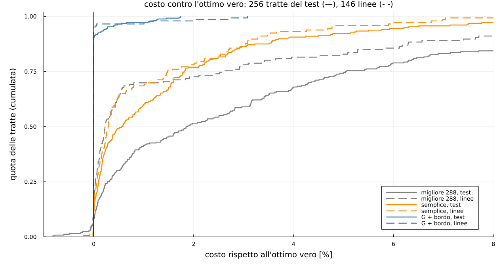

# Fase 16: la strategia G sulle tratte del test, contro l'ottimo vero

20/11/2026. Rete 6b, `surrogato/usa_surrogato.jl` senza modifiche (strategia G, margine sì), TrainPowertrain `7c9115a`, Julia 1.12.5, MacBook Air M4, 8 thread. Ambiente uguale a fase13 (`Project.toml` e `Manifest.toml` copiati).

## Perché

Sulle 146 linee reali (fase 13, `08_ottimo_vero`) la strategia G + bordo trova l'ottimo vero della griglia fitta in 139 linee. In media sta a +0,07% dall'ottimo e al massimo a +3,1%.

Però G e le mosse sul bordo sono state messe a punto proprio su quelle linee (fase 12, passi 13–16; fase 13, passo 07). Il risultato potrebbe quindi essere in parte adattato alle linee. Qui G si prova senza toccarla su tratte che non sono mai servite a svilupparla.

## Le tratte

Sono le stesse 256 tratte del passo 8a della fase 12:
- tratte del test DoE (gruppi Sobol 15 e 16, 2047 tratte senza la 14664);
- scelte a caso con il seme 20261117 (id da 14340 a 16380).

`01_tratte.jl` le ricostruisce e controlla che siano identiche a `fase12_log/01_griglia_tratte.csv`.

Nel passo 8a queste tratte erano servite solo a misurare la rete con la strategia semplice (rete + 5 verifiche). G è stata scritta dopo, e mai su tratte del test. La rete non le ha mai viste in addestramento.

Le tratte sono più lunghe delle linee: L va da 5 a 300 km, mediana 147 km contro 56 km delle linee. Hanno anche più ibridi:

| regime dell'ottimo | test | linee |
|---|---:|---:|
| sola batteria | 59 | 99 |
| ibrido FC piccola | 50 | 20 |
| ibrido | 147 | 27 |

Sono quindi un banco più difficile delle linee per il surrogato.

## Cosa si fa (`lancia.sh`)

Comando, dalle 09:44 alle 13:45:
```
cd "$ML" && nohup caffeinate -i bash fase16/lancia.sh >> ~/Documents/lavoro/ml_treno_dati/fase16_log/log.txt 2>&1 &
```

1. **`01_tratte.jl`**: il campione, come sopra.
2. **Surrogato** con `doe=<256 id> strategia=G margine=si`, poi `strategia=semplice`, sempre con `usa_surrogato.jl` così com'è.
   - I riepiloghi sono in `riepilogo_G.csv` e `riepilogo_semplice.csv`.
   - Le cartelle delle simulazioni sono in `ml_treno_dati/fase16/surrogato_G` e `surrogato_semplice`.
   - Le 16 cartelle che c'erano già in `ml_treno_dati/surrogato/` sono state salvate prima e rimesse al loro posto dopo; la cartella ha di nuovo 292 voci.
3. **`02_griglia.jl`**: l'ottimo vero.
   - Simula tutti i 9702 progetti della griglia fitta per ogni tratta: m ∈ {0} ∪ 0,03:0,01:0,99, n ∈ 0,01:0,01:0,99.
   - Percorso della campagna, con `config.txt` controllato contro quello di P9_D28_16384.
   - Si riprende per tratta. Uscite in `ml_treno_dati/fase16/griglia`.
4. **`03_confronto.jl`**: le metriche di `fase13/risultati/08_ottimo_vero.txt`, con le 146 linee accanto nella stessa tabella. I numeri delle linee sono riletti dai file della fase 13 e ridanno quelli di allora.

Controlli:
- il costo delle proposte G e semplice riletto dalla griglia coincide con quello del surrogato, con uno scarto massimo di 2,7e-07 e nessuna anomalia;
- nessuna tratta è senza progetti fattibili: in mediana sono fattibili 4912 progetti su 9702.

Nella griglia, 10 simulazioni su circa 2,5 milioni hanno dato l'avviso D28 del ciclo dello storage che non converge. Lì il simulatore usa il peso massimo del ciclo, come previsto dalla correzione c2af889.

Uscite:
- `risultati/03_confronto.txt` (tutti i numeri), `03_ottimo_tratte.csv` (una riga per tratta), `02_tempi.csv` e i log;
- `figure/fig_ottimo_test.png`.

## Risultati

### Il costo rispetto all'ottimo vero

| | test: migliore 288 | test: semplice | **test: G + bordo** | linee: migliore 288 | linee: semplice | **linee: G + bordo** |
|---|---:|---:|---:|---:|---:|---:|
| media | +3,62% | +1,44% | **+0,055%** | +2,19% | +1,13% | **+0,069%** |
| mediana | +1,87% | +0,57% | **0,000%** | +0,23% | +0,29% | **0,000%** |
| 90° percentile | +9,81% | +3,80% | **+0,001%** | +7,52% | +3,19% | **0,000%** |
| massimo | +23,8% | +11,9% | **+1,74%** | +18,0% | +13,0% | **+3,08%** |
| esattamente l'ottimo | 20 (8%) | 37 (14%) | **230 (90%)** | 20 (14%) | 14 (10%) | **139 (95%)** |
| entro 0,1% | 43 | 65 | **237 (93%)** | 50 | 45 | **141 (97%)** |
| entro 0,5% | 77 | 126 | **247 (96%)** | 92 | 93 | **141 (97%)** |
| entro 1% | 106 | 154 | **249 (97%)** | 102 | 100 | **141 (97%)** |
| oltre 2% | 124 | 59 | **0** | 40 | 32 | **3 (2%)** |
| oltre 5% | 65 | 20 | **0** | 25 | 6 | **0** |
| regime giusto | 237 | 247 | **256 (100%)** | 132 | — | **144 (99%)** |
| simulazioni per tratta | 288 | 5 | **56,2 (max 81)** | 288 | — | **55,0 (max 80)** |
| tempo per tratta | (campagna) | 0,10 s | **0,39 s** | (campagna) | — | **0,28 s** |

I conteggi sono su 256 tratte del test e su 146 linee.

Due avvertenze sulla tabella:
- **La migliore delle 288 può costare meno dell'ottimo della griglia** (17 tratte del test), perché le 288 coppie non stanno sulla griglia a passo 0,01.
- **Il tempo del surrogato** è per tratta, sul Mac, compresa la compilazione durante la prima tratta. L'avvio, 5,2 s, è a parte.



Lettura:
- **G + bordo** si comporta sul test come sulle linee.
  - Le medie quasi coincidono: +0,055% contro +0,069%.
  - La coda è più corta: massimo +1,74% contro +3,08%, e nessuna tratta oltre il 2% contro 3 linee.
  - Prende l'ottimo esatto un po' meno spesso: 90% contro 95%. Gli scarti però restano piccoli.
- **I due riferimenti peggiorano sul test**, G no.
  - La migliore delle 288 passa da +0,23% a +1,87% di mediana; la semplice da +0,29% a +0,57%.
  - Le tratte del test sono più difficili, perché sono più lunghe e hanno più ibridi.
  - Il guadagno di G sui riferimenti è quindi più grande sul test che sulle linee.
- **Il regime è giusto in tutte le 256 tratte.** Sulle linee G sbagliava in 2 casi: linee intorno ai 100 km, al confine fra FC piccola e ibrido. Sul test le 50 tratte con ottimo "ibrido FC piccola" sono tutte riconosciute.
- **Le proposte sono precise:**
  - nella classifica dei progetti fattibili, la proposta G è in mediana 1ª, al 90° percentile 2ª e nel caso peggiore 86ª;
  - il costo vicino all'ottimo è appuntito come sulle linee: in mediana solo 2 / 4 / 6 progetti stanno entro lo 0,1 / 0,5 / 1% (linee: 2 / 4 / 8). Prendere l'ottimo esatto non è quindi un effetto di un fondo piatto.

### Per regime e per lunghezza (G + bordo, test)

| | tratte | esattamente l'ottimo | entro 1% | oltre 2% | media | massimo |
|---|---:|---:|---:|---:|---:|---:|
| sola batteria | 59 | 59 | 59 | 0 | 0,000% | 0,000% |
| ibrido FC piccola | 50 | 49 | 50 | 0 | 0,000% | +0,017% |
| ibrido | 147 | 122 | 140 | 0 | +0,095% | +1,74% |
| L < 100 km | 90 | 90 | 90 | 0 | 0,000% | 0,000% |
| L 100–200 km | 91 | 84 | 88 | 0 | +0,061% | +1,74% |
| L ≥ 200 km | 75 | 56 | 71 | 0 | +0,112% | +1,71% |

Tutti gli scarti stanno negli ibridi delle tratte lunghe. Sotto i 100 km e nei regimi a batteria o FC piccola G trova sempre l'ottimo, salvo un caso a +0,017%.

### Le tratte con G oltre lo 0,5%

| tratta | L [km] | ottimo (m, n) | €/km | G (m, n) | G | sim. | migliore 288 | semplice |
|---|---:|---|---:|---|---:|---:|---:|---:|
| 15190 | 171,6 | (0,65; 0,32) | 6,20 | (0,50; 0,65) | +1,74% | 81 | +0,76% | +2,65% |
| 15066 | 272,1 | (0,99; 0,12) | 5,75 | (0,72; 0,55) | +1,71% | 60 | +0,61% | +2,76% |
| 14606 | 194,7 | (0,78; 0,14) | 6,46 | (0,57; 0,63) | +1,46% | 63 | +1,51% | +2,10% |
| 15758 | 196,9 | (0,57; 0,32) | 5,44 | (0,53; 0,58) | +1,28% | 38 | +0,19% | +1,39% |
| 16062 | 222,8 | (0,53; 0,25) | 4,51 | (0,50; 0,33) | +1,26% | 34 | +1,47% | +1,78% |
| 15191 | 294,4 | (0,77; 0,48) | 6,61 | (0,81; 0,45) | +1,20% | 34 | +1,60% | +1,20% |
| 16111 | 223,4 | (0,40; 0,50) | 4,74 | (0,35; 0,76) | +1,09% | 58 | +1,40% | +1,09% |
| 14490 | 265,4 | (0,53; 0,49) | 5,49 | (0,62; 0,26) | +0,66% | 35 | +0,90% | +0,70% |
| 14394 | 275,2 | (0,68; 0,27) | 4,63 | (0,60; 0,59) | +0,56% | 36 | +0,09% | +0,66% |

Sono 9 tratte, tutte ibride e lunghe 170–295 km. Hanno costi alti (4,5–6,6 €/km contro 2,9–4,1 delle linee peggiori).

Lo scarto ha una forma diversa da quello delle linee:
- **Sulle linee** G si fermava a un passo dall'ottimo, vicino al confine fra regimi: m sbagliata di 0,03–0,04.
- **Sul test** G si ferma in un'altra valle del costo. n è spesso lontana di 0,2–0,4 (fino a 0,49) e m fino a 0,27, ma il costo è quasi uguale.

In queste tratte il costo ha due minimi vicini in valore, uno con n bassa e uno con n alta. La ricerca locale parte vicino a quello sbagliato e non salta all'altro.

Solo in 4 tratte su 256 G costa più della migliore delle 288 (15190, 15066, 15758, 14394). Sempre in 4 costa più della semplice.

### Tempi

| | per tratta | note |
|---|---:|---|
| griglia fitta simulata | 55,9 s di orologio (mediana 51,2) | 8 thread; 20,2 h di calcolo in tutto; 238 min per le 256 tratte |
| surrogato G | 0,39 s | 56,2 simulazioni; circa 143 volte meno della griglia |
| surrogato semplice | 0,10 s | 5 simulazioni |

G impiega più tempo che sulle linee (0,39 s contro 0,28 s) solo perché le tratte sono più lunghe: ogni simulazione dura di più. Il numero di simulazioni è lo stesso: 56 contro 55.

## Limiti

- **Le tratte sono sintetiche.** Vengono dallo stesso DoE delle tratte di addestramento, anche se da gruppi Sobol mai usati. Il test misura la generalizzazione di G a tratte nuove dello stesso tipo, non a una rete ferroviaria diversa. Le linee reali restano il banco più vicino all'uso.
- **L'ottimo vero è quello della griglia a passo 0,01**, come nella fase 13. Fra un punto e l'altro della griglia può esserci di meglio. Lo stesso vale per la migliore delle 288 coppie.
- **256 tratte sono poche per la coda estrema.** Nessuna tratta oltre il 2% vuol dire che la frequenza vera è probabilmente sotto l'1,2% (regola del tre, 95%). È compatibile con il 2% delle linee: non si può dire che G sia migliore sul test, solo che non è peggiore.
- **I due banchi non hanno la stessa composizione di regimi.** Il test ha molti più ibridi lunghi, le linee più sola batteria. Il confronto è quindi fra i risultati complessivi di G, non regime per regime.

## Conclusione

**Il risultato sulle 146 linee si conferma su tratte indipendenti.**

Sulle 256 tratte del test, mai usate per sviluppare G, la strategia G + bordo:
- trova l'ottimo vero esatto in 230 tratte (90%) e sta entro l'1% in 249 (97%);
- in media sta a +0,055% dall'ottimo, contro +0,069% sulle linee;
- al massimo sta a +1,74%, contro +3,08% sulle linee;
- non ha nessuna tratta oltre il 2% e azzecca il regime in 256 su 256;
- fa lo stesso numero di simulazioni delle linee (56 contro 55).

I riferimenti invece peggiorano su queste tratte più difficili:
- la migliore delle 288: mediana +1,87%, 124 tratte oltre il 2%;
- la semplice: mediana +0,57%, 59 tratte oltre il 2%.

L'unica differenza è il tipo di errore residuo. Sulle linee era un piccolo spostamento al confine dei regimi; sul test è, in 9 ibridi lunghi, la scelta di una valle vicina in costo ma lontana in n. Lo scarto resta sotto il 2%.

Per l'articolo:

> On 256 held-out synthetic routes never used to design the search strategy, the surrogate-guided search (strategy G with boundary moves, ≈56 simulations per route) found the exact optimum of the 9702-point dense grid on 90% of routes and stayed within 1% on 97%. The mean excess cost was 0.055% (maximum 1.7%), and the powertrain regime was correct on every route. This matches the 146 real lines (95% exact, mean 0.069%, maximum 3.1%) at about 1/170 of the simulations of the full grid.
